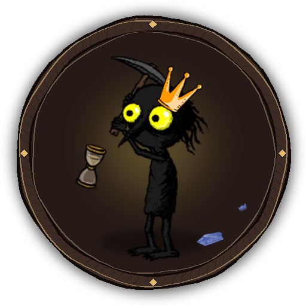

  

# The Longing Decrypted

An unofficial [Archipelago](https://archipelago.gg) multiworld and randomizer for *The Longing* (Studio Seufz).

Shuffle tools, keys, books, crystals, mushrooms, home comforts, progressive mobility, and time boosts across the Underground Kingdom, exchange items with players in other Archipelago worlds, and tailor the 400-day countdown to fit a real multiworld session.

- [Latest Release (`v1.1.0`)](https://github.com/Decryptu/thelonging-decrypted/releases/latest) — matched BepInEx 5 x86 plugin, `the_longing.apworld`, and PopTracker pack
- [Player hub & YAML generator](https://decryptu.github.io/thelonging-decrypted/)
- [Setup & save recovery guide](apworld/the_longing/docs/setup_en.md)
- [Development guide](DEVELOPMENT.md)
- [Roadmap](ROADMAP.md)

## Status

**Version 1.1.0** adds the Cavern Peddler, relics, hats, companions, and an interface built from the game's own art.

- **World & logic:** 66 playable rooms, 160 locations (including 7 room discoveries and 8 Peddler checks), and 99 items for Archipelago 0.6.8+ (`the_longing.apworld`), with YAML-less Universal Tracker support built in.
- **Client plugin (`mod/`):** BepInEx 5 x86 (`net472`) plugin with per-slot isolated saves (`Archipelago/<seed>_<slot>/`), persistent countdown checkpoints (`AP_CLOCK_OFFSET_SECONDS`), progressive walking pace (`1×`–`2×`), 3-ring native waypoint recall (**Shift-click Go or Home**), DeathLink, and everything you own shown in the game's own carved frame.
- **Trackers & hub:** Autotracking PopTracker pack (`the_longing_poptracker.zip`) and self-hosted [GitHub Pages player hub](https://decryptu.github.io/thelonging-decrypted/) with an option-synced YAML generator, interactive cavern map, and guided setup checklist.

## Features

- Full Archipelago 0.6.8+ multiworld support (`the_longing.apworld` + BepInEx 5 x86 Unity mod)
- Broad randomization coverage: mattocks, keys and doors, library books, crystals, mushrooms, moss, home comforts, musical instrument parts, coal/sulfur, progressive walk speed, progressive waypoint recall, and time-skip / time-rate boosts
- The Cavern Peddler's stall, reusable relics with real cooldowns, hats that follow every animation, and companions
- Multiworld pacing and save safety: configurable countdown length (`1_hour` to `400_days`), starting time rate, isolated per-slot randomizer saves that leave vanilla `saveDataNew.txt` untouched, and offline-safe countdown checkpoint recovery
- First-party player hub with a browser YAML generator, interactive cavern map, and setup checklist, plus PopTracker and Universal Tracker packs

## Credits & License

Unofficial fan project. Not affiliated with Studio Seufz or Application Systems Heidelberg. *The Longing* and its assets belong to their respective owners.

Distributed under the [MIT License](LICENSE).
